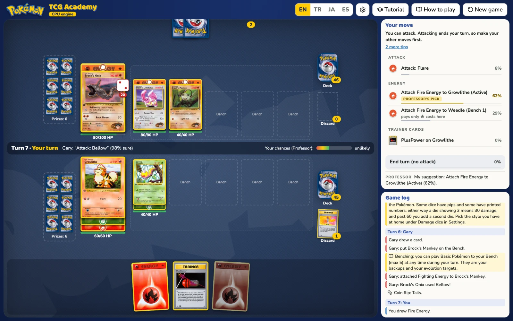
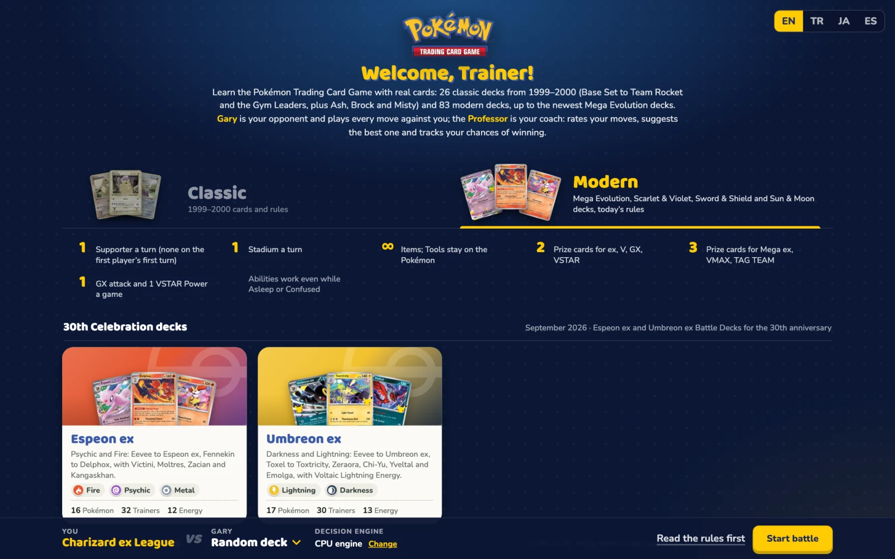
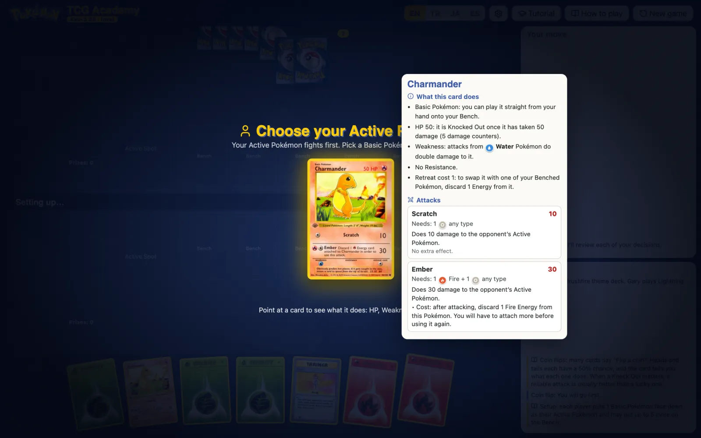
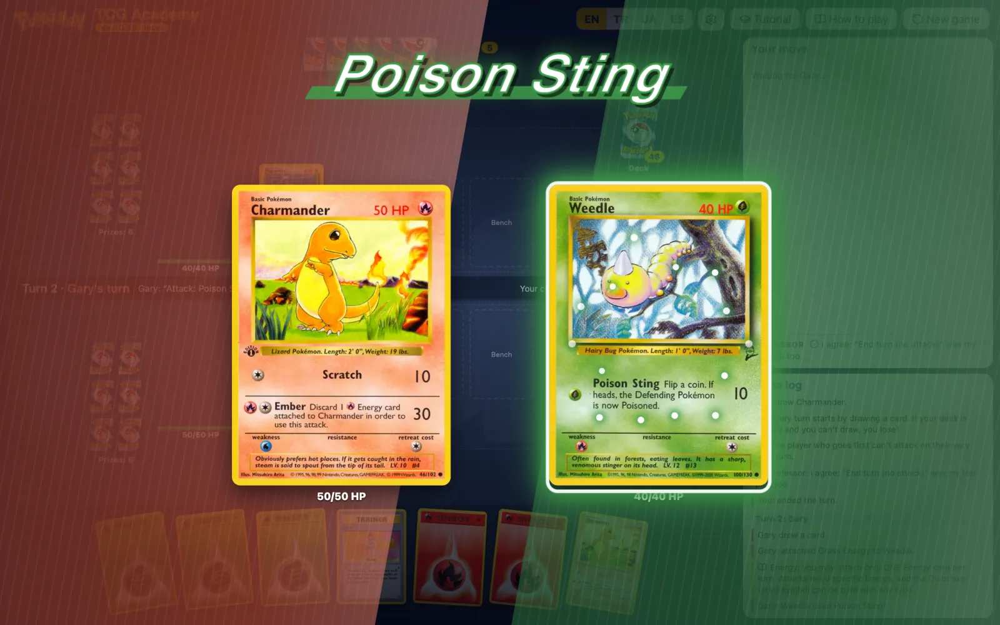
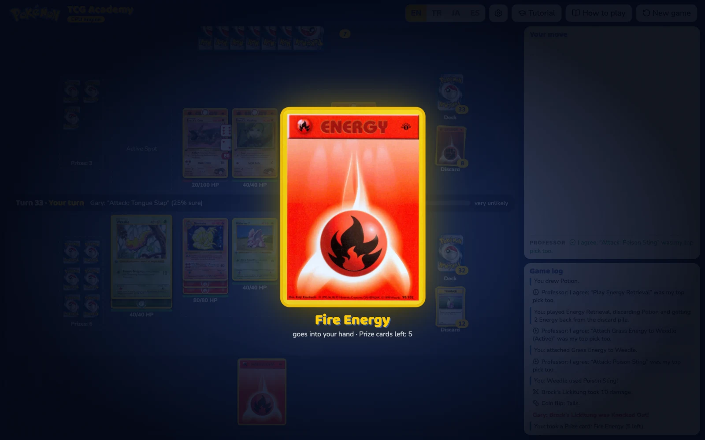
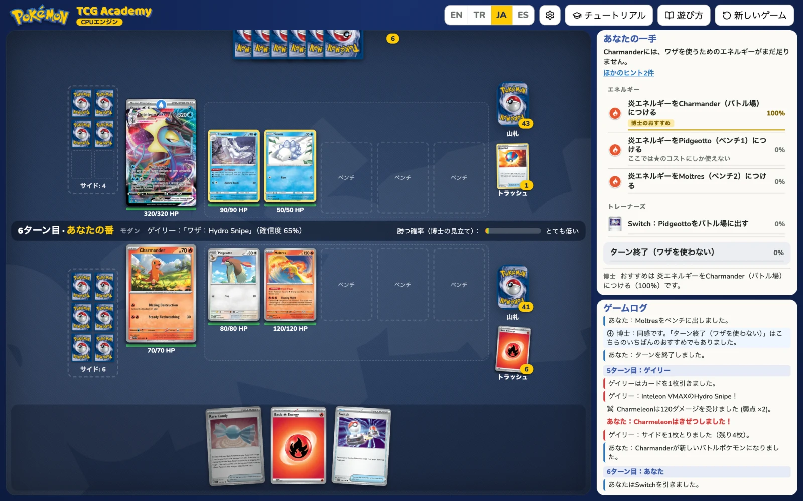
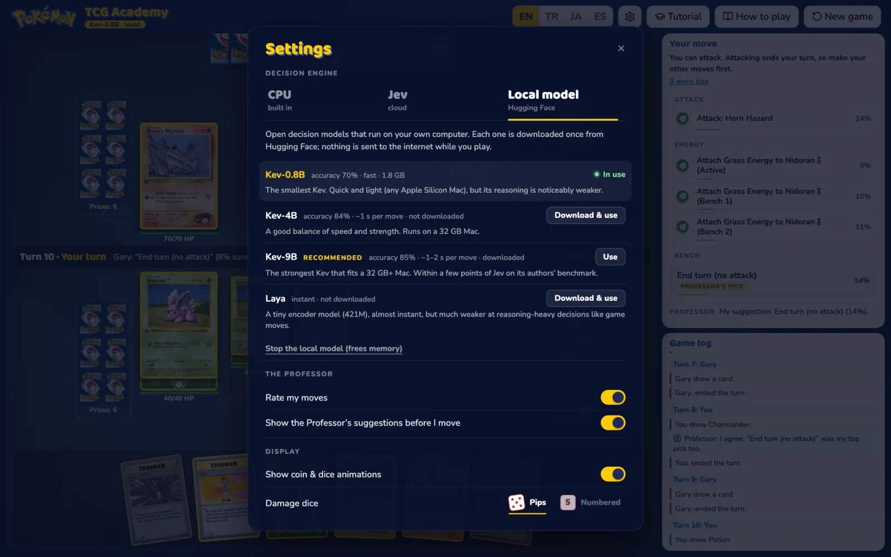

<p align="center">
  
</p>

<h1 align="center">Pokémon TCG Academy</h1>

<p align="center">
  Learn the Pokémon Trading Card Game by playing it: 109 real decks, an AI opponent, and a coach that explains every move.<br>
  In English, Turkish, Japanese and Spanish. Runs in the browser or as a macOS app, and works offline.
</p>

<p align="center">
  <a href="https://github.com/f/pokemon-tcg/releases/latest"></a>
  <a href="LICENSE"></a>
  
  
</p>

<p align="center">
  <a href="https://pokemon.space.fast">Play online</a> ·
  <a href="#install">Install</a> ·
  <a href="#features">Features</a> ·
  <a href="#screenshots">Screenshots</a> ·
  <a href="#decision-engines">Engines</a> ·
  <a href="#development">Development</a> ·
  <a href="#contributing">Contributing</a> ·
  <a href="#license">License</a>
</p>

<p align="center">
  
</p>

## Install

### Play in your browser

**[pokemon.space.fast](https://pokemon.space.fast)**: the landing page, and the game itself at [/play](https://pokemon.space.fast/play/).
The browser version plays with the built-in CPU engine and needs nothing installed. For smarter opponents (Kev on your Mac, Jev in
the cloud) and offline play, install the macOS app.

### macOS app

```bash
brew install --cask f/tap/pokemon-tcg
```

This installs **Pokemon TCG** to your Applications folder (Apple Silicon, macOS 11 or newer). Card images, fonts and icons ship inside the app, so it plays with no internet connection.

The app is ad-hoc signed, not notarized with an Apple Developer ID. The cask removes the download quarantine for you. If you install the DMG from [Releases](https://github.com/f/pokemon-tcg/releases) by hand, macOS blocks the app the first time: allow it in **System Settings → Privacy & Security**, then open it again.

### Run it from source

You need Node 21.7+ and `cwebp` (`brew install webp`). This version can use every engine (CPU, Kev and Jev).

```bash
git clone https://github.com/f/pokemon-tcg.git
cd pokemon-tcg
npm install
npm run images   # downloads the card images and makes the WebP copies the game uses
npm start        # → http://localhost:8787
```

### Play a friend (multiplayer, preview)

**[pokemon-versus.space.fast](https://pokemon-versus.space.fast)**: sign in, pick a deck, and send your opponent a
private invite link. Only the two players can see a game.
- **Who runs the game:** the player who creates the match is the host and runs the game in their browser. The other
  player only receives what they're allowed to see.
- **Connection:** moves go directly between the two browsers (WebRTC). Each player can choose to relay them through
  Spacefast instead, which keeps their IP address private.
- **Code:** the lobby is a Spacefast Zero app in [`versus/`](versus/). The game side is in `public/net/`.

## Features

- **Real decks, real rules.** 26 classic decks from 1999–2000 are played with the rules of that era. 83 modern decks, up to the newest Mega Evolution decks, are played with today's rules. Every card works as printed.
- **Gary, your opponent.** Gary plays every move against you, with the decision engine you choose.
- **The Professor, your coach.** The Professor rates your options while you play and marks the best one. After each move you get a comment, and the Professor tracks your chances of winning.
- **Learn as you go.**
  - Hover over any card to see what it does in plain words.
  - Tips explain the rule behind each move.
  - A guided tour walks you through the table, and the How to play page has a diagram of a real card.
- **A table that feels like one.** Coins flip, damage dice roll and attacks play out in an anime-style arena. Prize cards spin as they are revealed, and Dan's Rock-Paper-Scissors becomes a shōnen-manga showdown.
- **Drag and drop.** Pick up a card and only the places it can legally go light up.
- **Four languages.** English, Türkçe, 日本語 and Español cover every screen, rule, card explanation and deck description.
- **Offline.** The built-in CPU engine and local models need no internet. Your game is saved before every decision and resumes where you left off.
- **macOS app.** The app has no title bar (drag the top bar to move the window). Your Jev API key stays in the macOS Keychain.

## Screenshots

<table>
  <tr>
    <td width="50%"><br><sub><b>Pick a deck.</b> Classic or Modern; the rules that change are listed under the tabs.</sub></td>
    <td width="50%"><br><sub><b>Every card explained.</b> Point at any card for its HP, Weakness, Retreat and attacks in plain words.</sub></td>
  </tr>
  <tr>
    <td><br><sub><b>Attack arena.</b> Both Active Pokémon meet in the middle of the board.</sub></td>
    <td><br><sub><b>Prize cards.</b> Pick one face down and it flips to reveal itself.</sub></td>
  </tr>
  <tr>
    <td><br><sub><b>日本語 · Modern rules.</b> The Charizard ex League deck against an Inteleon VMAX.</sub></td>
    <td><br><sub><b>Settings.</b> Choose Gary's engine and download local models.</sub></td>
  </tr>
</table>

## Decision engines

Gary and the Professor think with the engine you pick in **Settings** (the gear button, or the engine badge under the title).

| Engine | What it is | Needs |
| --- | --- | --- |
| **CPU** | A rule-based player built into the game | Nothing. Works offline |
| **Local model** | An open decision model from Hugging Face, downloaded once and run on your machine | [uv](https://docs.astral.sh/uv/), disk space and RAM for the model. Works offline after the download |
| **Jev** | TypeSafe's hosted decision model | Internet and a Jev API key. The app stores the key in the macOS Keychain; the web version stores it in `.env` and never sends it back to the browser |

| Local model | Download | Notes |
| --- | --- | --- |
| [Kev-0.8B](https://huggingface.co/jaredpalmer/kev-0.8b) | 1.8 GB | Fast, but noticeably weaker reasoning |
| [Kev-4B](https://huggingface.co/jaredpalmer/kev-4b) | ~9 GB | Balanced; runs on a 32 GB Mac |
| [Kev-9B](https://huggingface.co/jaredpalmer/kev-9b) | 19.5 GB | **Recommended.** The strongest that fits a 32 GB+ Mac |
| [Laya](https://huggingface.co/convaiinnovations/laya) | ~2.3 GB | Tiny encoder, near-instant, much weaker at game decisions |

[Kev](https://github.com/jaredpalmer/kev) is a family of open (Apache-2.0) decision models built on Qwen3.5. Kev speaks the same System One API as Jev: yes/no, choice and score questions, with calibrated probabilities. On its authors' held-out benchmark, Kev-9B scores 0.82 (dev) and 0.85 (test), against 0.86 for Jev.

The first time you pick a Kev model, the game clones and installs Kev and shows download progress in Settings. The model then runs on port 8009.
- The web server puts Kev in `../kev` (or `KEV_DIR`). The app keeps it in its Application Support folder.
- The weights stay in the Hugging Face cache, so the web version and the app share them.
- Laya runs through `uvx`.

While a model is downloading or loading, Gary plays with the CPU engine. Jev is switched off whenever you're offline.

## Decks and rules

Pick **Classic** or **Modern** on the home screen. Modern rules apply automatically when both decks are modern:
- 1 Supporter per turn, and none on the first player's first turn.
- Any number of Items, and 1 Stadium per turn.
- Pokémon Tools stay attached, 1 per Pokémon.
- Abilities work even while the Pokémon is Asleep, Confused or Paralyzed.
- Pokémon ex, V, VSTAR and GX give up 2 Prize cards; Mega Evolution Pokémon ex, VMAX and TAG TEAM give up 3.
- Each player can use 1 GX attack and 1 VSTAR Power per game.

<details>
<summary><b>All 109 decks</b></summary>

**Classic (1999–2000)**

- **Anime trainers:** Ash, Brock and Misty, built from the Pokémon each of them owns in the anime.
- **Base Set theme decks:** Brushfire, Overgrowth, Zap! and Blackout.
- **Jungle:** Water Blast and Power Reserve. **Fossil:** LockDown and BodyGuard.
- **Base Set 2:** Grass Chopper, Hot Water, Lightning Bug, Psych Out and Thunderstorm.
- **Team Rocket:** Devastation and Trouble.
- **Gym Heroes:** Brock's Rock, Misty's Water, Lt. Surge's Lightning and Erika's Garden.
- **Gym Challenge:** Sabrina's Psychic, Koga's Poison, Blaine's Fire and Giovanni's Earth.

**Modern**

- **30th Celebration (September 2026):** the Espeon ex and Umbreon ex Battle Decks.
- **Mega Evolution:** Mega Gengar ex and Mega Diancie ex Mega Battle Decks; Mega Lucario ex and Mega Greninja ex League Battle Decks.
- **Rival Battle Decks:** Marnie and Steven.
- **Deluxe Battle Decks:** Meowscarada ex, Quaquaval ex, Ninetales ex, Zapdos ex, Koraidon ex and Miraidon ex.
- **ex Battle Decks:** Ampharos ex, Lucario ex, Chien-Pao ex, Tinkaton ex, Greninja ex, Kangaskhan ex, Houndoom ex, Melmetal ex, Victini ex, Miraidon ex, Tapu Koko ex and Iron Leaves ex.
- **League Battle Decks:** Miraidon ex, Gardevoir ex, Charizard ex, Dragapult ex and Team Rocket's Mewtwo ex.
- **Sword & Shield League Battle Decks:** Zacian V, Inteleon VMAX, Rapid Strike and Single Strike Urshifu VMAX, Ice Rider and Shadow Rider Calyrex VMAX, Mew VMAX and Origin Forme Palkia VSTAR.
- **Sword & Shield V Battle Decks:** Venusaur V, Blastoise V, Victini V, Gardevoir V, Rayquaza V, Noivern V, Lycanroc V, Corviknight V, Mewtwo V, Melmetal V, Zeraora V and Deoxys V.
- **Sword & Shield theme decks:** Rillaboom, Cinderace, Inteleon, Zacian, Zamazenta, Galarian Darmanitan, Galarian Sirfetch'd, Charizard and Drednaw.
- **Sun & Moon theme decks:** all 23, from Forest Shadow, Roaring Heat and Bright Tide to Lightning Loop and Battle Mind, including Let's Play, Pikachu! and Let's Play, Eevee!.

</details>

Games use 6 Prize cards and today's turn structure: the first player can't attack on their first turn. In classic games, Base Set Trainers can be played without limit each turn, as they were in 1999. Confusion follows the modern rule: on tails, the attack fails and the Pokémon takes 30 damage.

## Development

| Command | What it does |
| --- | --- |
| `npm start` | Web version at http://localhost:8787 |
| `npm run images` | Downloads the card images (safe to re-run) |
| `npm test` | Rules checks plus thousands of headless games on every deck |
| `npm run test:rules` | Only the 257 hand-built rule checks (fast) |
| `npm run test:kev` | 40 games against the local Kev model (port 8009) |
| `npm run app:dev` | The macOS app in development mode |
| `npm run app:build` | The release app and DMG in `src-tauri/target/release/bundle/` |
| `npm run test:versus` | Headless two-player games (host + guest in a worker) with a privacy check on every message |
| `npm run versus:frame` | The game frame for two-player matches in `site-versus-play/` |
| `npm run web:build` | The hosted web version in `site/`: the landing page and the CPU-only game (`npm run web:publish` builds and publishes it to Spacefast) |

Building the app needs [Rust](https://rustup.rs) and the Xcode Command Line Tools as well.

### How it fits together

The game is plain JavaScript ES modules with no framework: `public/` is the whole game, and the dev server runs it as is.
- **Rules engine:** `public/engine.js` has no DOM code. The player's UI and the AI connect to it as controllers.
- **Card rules by era:** a chain of engine files adds them, in this order: `engine-modern.js` → `engine-mega.js` → `engine-swsh.js` → `engine-swsh-v.js` → `engine-sm.js`.
- **Backend:** `server.js` serves the files and answers the `/api` calls for engines and decisions.
- **macOS app:** a [Tauri 2](https://tauri.app) shell around the same files. `src-tauri/src/main.rs` answers the same `/api` calls through `invoke`, keeps the Jev key in the Keychain and runs the local model server.
- **Hosted web version:** `scripts/build-web.mjs` builds the same files into `site/play/` and marks the page with
  `<meta name="tcg-build" content="web">`. With that marker `api.js` answers locally with the CPU engine and never calls a server, and
  Settings points to the macOS app for Kev and Jev. The build also bundles the modules (esbuild), the classic decks and the icons, so a
  static host gets few requests, and points the card images at the public card image CDN. The landing page is in `web/`.

One codebase, three targets: a change in `public/` reaches the dev server, the app and the hosted version on their next build.

| Path | What it does |
| --- | --- |
| `public/engine*.js` | Rules engine and card effects for each era |
| `public/ai.js` | Gary's controller: the CPU engine, and the state and questions sent to a decision model |
| `public/ui.js` | Board, hand, move list, coach, animations and Settings |
| `public/rps.js` | The anime-style Rock-Paper-Scissors stage for Dan |
| `public/i18n.js`, `public/i18n/*.js` | `t()` and every string in four languages, including the How to play pages |
| `public/api.js` | Backend calls: `fetch` with the dev server, Tauri `invoke` in the app, nothing in the hosted web build (CPU only) |
| `public/data/decks/` | One folder per deck with its `cards.json`, plus `index.json` (deck order and groups) |
| `public/vendor/` | Local copies of the icons and fonts, for offline play |
| `server.js` | Static server, engine switching and the local model process |
| `src-tauri/` | The macOS app: window without a title bar, engines, Keychain, local models, icons |
| `web/` | The landing page (four languages), `robots.txt`, `sitemap.xml`, the 404 page and the Spacefast settings (`sf.jsonc`) |
| `scripts/` | Image download and WebP conversion, the `dist/` and `site/` builds, the DMG and the app icon |
| `tests/` | Headless rules checks, prize counts, card coverage, save/restore, stalled-game and model tests |

### Adding a deck

Each deck is one file, `public/data/decks/<deck>/cards.json`. It has the deck's name, types and featured cards. Each card entry has:
- its count, stats and image;
- how each attack works (`effect`);
- any Pokémon Power or Ability (`power.kind`);
- what a Trainer does (`trainer`).

Add a folder, list it in `index.json`, run `npm run images`, then `npm test`. The coverage test reports any attack effect, Trainer or Ability that never ran.

## Contributing

Issues and pull requests are welcome: bug reports with the deck and the turn, card rules that don't work as printed, new decks and translation fixes.

- Run `npm test` before you open a pull request. Add a rule check in `tests/rules.mjs` for a card you fix or add.
- UI text goes through `t()`. Add new keys to all four files in `public/i18n/` (English, Turkish, Japanese and Spanish).
- Don't commit card images, `.env` or `decision.json`. They are git-ignored.

## Credits

- **Card data and images:** the [Pokémon TCG API](https://pokemontcg.io) dataset ([PokemonTCG/pokemon-tcg-data](https://github.com/PokemonTCG/pokemon-tcg-data)), plus four promo cards from [TCGdex](https://tcgdex.dev).
- **Decklists:** Bulbapedia, and [Coded Yellow](https://www.codedyellow.com/30th-celebration-battle-decks-espeon-umbreon/) for the 30th Celebration decks.
- **Decision models:** [Kev](https://github.com/jaredpalmer/kev) and [Laya](https://huggingface.co/convaiinnovations/laya).
- **Icons and fonts:** [Lucide](https://lucide.dev) icons (ISC), [Pokémon type icons by duiker101](https://github.com/duiker101/pokemon-type-svg-icons) (MIT), and the fonts Baloo 2, Nunito and Dela Gothic One (SIL OFL).

## License

The code is [MIT](LICENSE) licensed. See [NOTICE](NOTICE) for the third-party assets.

Pokémon, the Pokémon logo, card names, card text and card images are © Nintendo / Creatures / GAME FREAK / The Pokémon Company. This is a fan-made, non-commercial learning tool, not affiliated with or endorsed by them. The repository doesn't contain the card or logo image files (the screenshots in `docs/` show them in play). `npm run images` downloads them from the public Pokémon TCG API image service.
